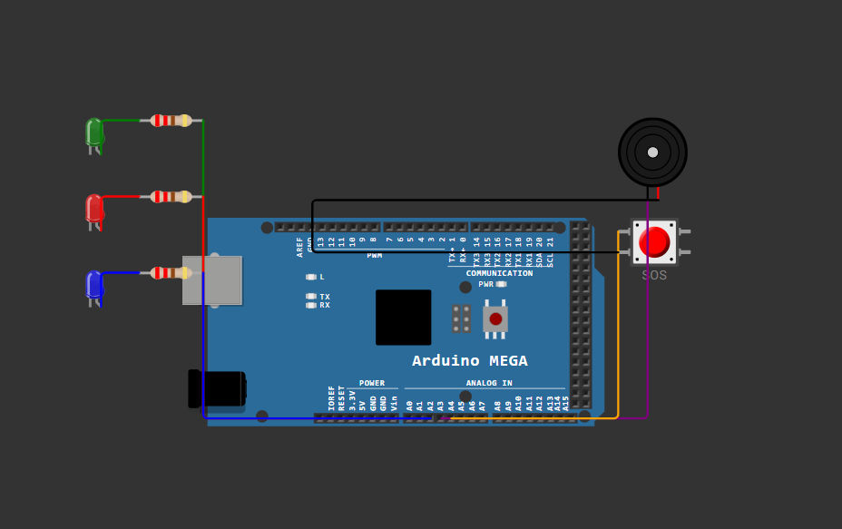

<div align="center">

# 🚨 DisasterLink · Kit de Emergência

**O kit que fica na área do desastre, recebe o pedido de socorro da vítima e garante que ele chegue à Defesa Civil**

[](https://wokwi.com/projects/465923138582135809)


<sub>Edge Computing & Computer Systems · Global Solution 2026.1 · Space Connect · FIAP</sub>

<a href="https://wokwi.com/projects/465923138582135809"></a>

</div>

---

## Sobre o projeto

Quando uma enchente, um desabamento ou um incêndio acontece, a comunicação costuma cair junto: sem sinal de celular, sem internet e, muitas vezes, sem luz. As vítimas não conseguem pedir socorro, as equipes de resgate não sabem para onde ir e a Defesa Civil coordena as ações às cegas. Foi o que aconteceu no Rio Grande do Sul em 2024, quando municípios inteiros ficaram dias sem comunicação.

O **DisasterLink** nasceu para manter esse canal aberto. A solução completa reúne um **kit de emergência portátil**, uma central de comando para a Defesa Civil e um aplicativo para as equipes de resgate. O kit recebe os pedidos de socorro das vítimas por rádio LoRa e envia as informações pela rede 4G ou, quando ela falha, pelo satélite Iridium. Assim, a comunicação funciona em qualquer lugar do planeta, sem depender da infraestrutura terrestre.

Este repositório traz o **kit de emergência**, simulado com Arduino Uno. Ele representa o momento mais importante da solução: a vítima aperta o **botão SOS**, o kit recebe o sinal com a localização, tenta enviar pela rede 4G e, quando ela falha, usa o **satélite Iridium** como plano B. LEDs e buzzer mostram ao operador do kit, em campo, o que está acontecendo.

O objetivo é simples: que nenhum pedido de socorro se perca quando a comunicação cai, e que o resgate chegue primeiro a quem mais precisa.

> **Importante:** os módulos reais (LoRa, GPS, modem 4G e modem Iridium) são **simulados no código**, com mensagens no Monitor Serial. Os LEDs, o buzzer e o botão são os componentes físicos do circuito.

---

## Como a solução funciona

A solução foi pensada em três camadas:

| Camada | O que acontece |
|---|---|
| **1. Pedido de socorro** | A vítima conecta o celular ao Wi-Fi do kit e preenche um formulário rápido, ou simplesmente aperta o botão SOS de um chaveiro com rádio LoRa (alcance de até 5 km). |
| **2. Envio** | Os dados chegam ao centro de comando pela rede 4G ou, quando ela falha, pelo satélite Iridium, com confirmação de recebimento em menos de 3 minutos. |
| **3. Resposta** | A Defesa Civil acompanha um mapa das vítimas em tempo real, as equipes usam um app que funciona offline e os casos médicos graves geram alertas automáticos no WhatsApp. |

---

## Fluxo do SOS

Ao ser ligado, o kit acende o **LED verde** (sistema funcionando) e o **LED azul** (módulo LoRa ativo) e mostra no Monitor Serial que LoRa, GPS e satélite estão prontos. Quando o botão SOS é apertado:

| Etapa | O que acontece | Aviso no kit |
|---|---|---|
| **1. SOS recebido** | O sinal LoRa chega com a latitude, a longitude e a distância da vítima até o kit | 🔴 LED vermelho pisca |
| **2. Tentativa pelo 4G** | O kit tenta enviar os dados pela rede celular | — |
| **3. Falha do 4G** | Não há sinal na área, então o canal principal está indisponível | — |
| **4. Envio pelo satélite** | Os dados vão pelo Iridium e a Defesa Civil é avisada | 🔊 Dois bipes no buzzer |

O kit também conta quantos SOS já recebeu, e cada novo pedido aparece numerado no Monitor Serial.

---

## Circuito

| Componente | Quantidade | Pino | Função |
|---|---|---|---|
| Arduino Uno | 1 | — | Microcontrolador principal |
| LED verde | 1 | A0 | Sistema ligado e funcionando |
| LED vermelho | 1 | A1 | Pisca ao receber um SOS |
| LED azul | 1 | A2 | Módulo LoRa ativo |
| Buzzer passivo | 1 | A3 | Confirma o envio pelo satélite |
| Botão | 1 | A4 | Simula o chaveiro SOS da vítima (`INPUT_PULLUP`) |
| Resistor 220 Ω | 3 | — | Proteção dos LEDs |

```
Arduino Uno
│
├── A0 ──[220Ω]── LED verde    ── GND
├── A1 ──[220Ω]── LED vermelho ── GND
├── A2 ──[220Ω]── LED azul     ── GND
├── A3 ────────── Buzzer (+)   ── GND
└── A4 ────────── Botão SOS    ── GND
        (INPUT_PULLUP interno, sem resistor externo)
```

---

## Como executar

### Pelo Wokwi

1. Abra a [simulação no Wokwi](https://wokwi.com/projects/465923138582135809)
2. Clique em **▶ Play**
3. Abra o **Monitor Serial** na barra inferior
4. Clique no botão do circuito para simular o SOS e acompanhe as mensagens

<details>
<summary><b>Pelo Tinkercad</b></summary>

1. Em [tinkercad.com](https://www.tinkercad.com), clique em **Criar → Circuito**
2. Monte o circuito seguindo a tabela de pinos acima
3. Em **Código**, escolha o modo **Texto**, apague o código padrão e cole o conteúdo de `DisasterLink.ino`
4. Clique em **Iniciar Simulação** e aperte o botão do circuito

</details>

<details>
<summary><b>No hardware físico</b></summary>

1. Monte o circuito na protoboard seguindo a tabela de pinos
2. Abra `DisasterLink.ino` na [Arduino IDE](https://www.arduino.cc/en/software)
3. Selecione a placa em **Ferramentas → Placa → Arduino Uno** e a porta em **Ferramentas → Porta**
4. Clique em **Upload** (`Ctrl + U`)
5. Abra o **Monitor Serial** em **9600 baud** e aperte o botão

</details>

---

## Estrutura

```
kit-de-emergencia/
├── DisasterLink.ino   ← Código-fonte do kit
├── DisasterLink.png   ← Imagem do circuito no Wokwi
└── README.md          ← Este arquivo
```

---

## Limitações desta versão

O kit é um **protótipo acadêmico**. Nesta versão:

- LoRa, GPS, 4G e Iridium são simulados com mensagens no Monitor Serial.
- A localização e a distância da vítima são geradas aleatoriamente, perto de Porto Alegre.
- O 4G sempre falha, para mostrar o envio pelo satélite.
- O portal Wi-Fi para a vítima não faz parte desta simulação.

## Tecnologias utilizadas

- **Arduino Uno com C++:** lógica do kit.
- **Wokwi e Tinkercad:** simulação do circuito.
- **Arduino IDE:** gravação no hardware físico.

## Equipe

| Nome | RM |
|---|---|
| Caique Kenji Yafuco | 570368 |
| Guilherme Tomé Nogueira | 570144 |
| Lucas de Andrade Astorini | 569119 |
| Sabrina Lopes da Silva | 571870 |
| Sofia Satomi Hagio | 569120 |
